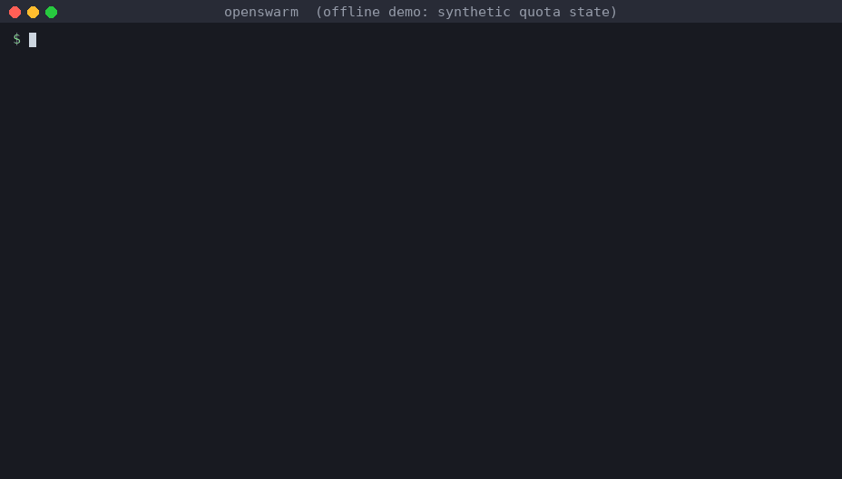

# openswarm

[](https://github.com/surlymochan/openswarm/actions/workflows/ci.yml)
[](LICENSE)


**Claude plans. Codex, OpenCode Go and DeepSeek write the code.**

openswarm is a quota-aware dispatcher for coding agents. Your planner (Claude Code) breaks work into tasks and
reviews the results. openswarm sends each task to the cheapest executor that can handle it, runs it in an
isolated git worktree with a hard time budget, checks the result on the host, and reports back. Nothing
runs forever.



<sub>The demo runs offline against a synthetic quota state (`examples/demo-state.json`), so you can reproduce
it without any backend installed.</sub>

## Why

If you pay for several AI subscriptions, the scarce one is usually the planner. Claude Pro runs out long
before a Codex or OpenCode Go plan does. Spending Claude tokens on typing out a refactor wastes the
expensive model.

openswarm splits the work:

- **Claude** decomposes the task, writes acceptance criteria, reviews diffs and integrates.
- **Executors** do the typing:
  - [Codex CLI](https://github.com/openai/codex) is the main executor.
  - [OpenCode](https://opencode.ai) Go handles cheap or mechanical work, non-GPT second opinions, overflow, and 1M context.
  - DeepSeek is the metered last resort.

Routing decisions use live quota data, not guesses.

## Features

- **Live model discovery.** Reads the current Codex and OpenCode model catalogues and sorts them into tiers (fast, balanced, deep). Legacy models go last.
- **Quota-aware routing.** Looks at 5-hour, 7-day and 30-day windows, burn pace and reset times:
  - At the soft limit, easy work spills to other backends.
  - A hard limit skips the backend.
  - Quota that is about to expire unused gets spent at higher effort.
- **Isolated execution.** Each run gets its own `git worktree` and `openswarm/<id>` branch.
  - Dependency dirs (`node_modules`, `.venv`) are symlinked in and never committed.
  - Nothing is pushed.
- **Hard budgets.** `--budget-minutes` kills the executor's whole process tree. Watchers expire too, and you re-arm them on purpose.
- **Host-side verification.** `--verify '<cmd>'` runs your test command on the committed worktree.
  - Its exit code overrides the executor's self-report.
  - `--verify-baseline` ignores failures that already exist on the base commit.
- **Automatic fallback.** Rate limits and model-at-capacity errors trip a 30-minute breaker, and the task moves to the next backend in the same worktree.
- **Risk alerts.** `openswarm watch` streams progress and flags dangerous executor commands (push, `rm -rf ..`, secret prints, `sudo`, publish). It also reports stalls and heartbeats.
- **Planner-friendly.**
  - `SKILL.md` teaches Claude Code the whole loop.
  - `templates/openswarm-workflow.js` fans tasks out in parallel.
  - `openswarm report` gives scheduled check-ins.
- **Zero dependencies.** One Python file using only the standard library.

## Quickstart

Requirements: Python 3.9+, git, and at least one executor: `codex` CLI logged in, `opencode` with an
OpenCode Go plan, or a DeepSeek API key.

```bash
# 1. Install as a Claude Code skill
git clone https://github.com/surlymochan/openswarm.git ~/.claude/skills/openswarm
alias openswarm=~/.claude/skills/openswarm/bin/openswarm

# 2. See what you have: plans, quotas, models, recommended concurrency
openswarm status --refresh

# 3. Ask where a task would go, without running anything
openswarm route --type impl --difficulty 3

# 4. Run a task in an isolated worktree with a 15-minute budget and a host-side test gate
cat > /tmp/task.md <<'TASK'
Add input validation to src/parse.ts: reject empty strings with a ParseError.
Acceptance: new unit test in test/parse.test.ts passes; existing tests still pass.
TASK
openswarm run --cwd ~/code/myrepo --type impl --difficulty 2 --budget-minutes 15 \
  --verify 'npm test' --task-file /tmp/task.md

# 5. Review and merge (openswarm never merges or pushes for you)
git -C ~/code/myrepo merge --no-ff openswarm/<run-id>
```

For longer work, detach and watch:

```bash
openswarm run --detach --cwd ~/code/myrepo --verify 'pytest -q' --task-file /tmp/task.md   # prints {"id": ...}
openswarm watch <id1> <id2>          # one line per actionable event; exits on DONE or after 28 min
openswarm report --since-minutes 60  # one-screen digest for scheduled check-ins
openswarm stop <id>                  # kill the executor; partial work is still committed to its branch
```

You can try routing with no backend installed:

```bash
OPENSWARM_HOME=$(mktemp -d) OPENSWARM_STATE_FILE=examples/demo-state.json bin/openswarm status
```

In Claude Code, just say things like *"dispatch this to Codex"*, *"swarm these five refactors"*, or *"use
openswarm"*. The skill takes it from there.

## How routing works

| Input | Effect |
| --- | --- |
| `--type review/audit` | Goes to a non-GPT family first (OpenCode Go) for an independent opinion |
| `--type mechanical/docs/test` at difficulty ≤ 2 | OpenCode Go first, to save Codex |
| `--difficulty 1..5` | Sets tier and effort: fast/low, fast/medium, balanced/medium, balanced/high, deep/high |
| `--context-tokens` > 220k | Prefers 1M-context backends |
| A window ≥ 95% used | Skips the backend |
| A window ≥ 85% used | Spills difficulty ≤ 3 to other backends; harder tasks stay with effort −1 |
| Burn pace > 1.25× even | Effort −1 |
| Resets within 24h with < 60% used | Effort +1, so quota isn't wasted |
| DeepSeek balance below floor | Skips DeepSeek |

The full rules are in [`SKILL.md`](SKILL.md#7-routing-rules-what-route-does). Every threshold is in
[`policy.json`](policy.json).

## Architecture

```
        ┌──────────── planner (Claude Code + SKILL.md) ────────────┐
        │  decompose → acceptance criteria → review → integrate    │
        └───────┬──────────────────────────────────────▲───────────┘
                │ openswarm run / route / watch           │ result.json, diff, verify
        ┌───────▼──────────────────────────────────────┴───────────┐
        │ openswarm                                                   │
        │  probe ─► state.json (models, tiers, quotas, breakers)   │
        │  route ─► backend/model/effort + reasons + fallbacks     │
        │  run   ─► git worktree ─► executor ─► commit ─► verify   │
        │  watch ─► MSG / RISK / STALL / BUDGET / DONE             │
        └───────┬───────────────────┬───────────────────┬──────────┘
          codex exec          opencode run         opencode run
         (Codex plan)       (OpenCode Go plan)    (DeepSeek API)
```

| Path | What |
| --- | --- |
| `bin/openswarm` | The CLI: `probe`, `status`, `route`, `run`, `watch`, `runs`, `report`, `stop`, `ingest-claude`, `ledger` |
| `SKILL.md` | Claude Code skill: the planner's operating manual |
| `policy.json` | Defaults: thresholds, difficulty map, model caps, local data sources |
| `backends/*.json` | One manifest per executor: invocation, quota source, data boundary |
| `templates/openswarm-workflow.js` | Parallel fan-out template for Claude Code workflows |
| `examples/demo-state.json` | Synthetic state for offline demos |
| `~/.claude/openswarm/` (`$OPENSWARM_HOME`) | Runtime data: `state.json`, `ledger.jsonl`, `breakers.json`, `runs/<id>/` |

## Configuration

Override any key in `$OPENSWARM_HOME/policy.local.json`. It is deep-merged over `policy.json`.

```json
{
  "codex": {"plan": "plus"},
  "claude": {"plan": "pro"},
  "thresholds": {"window_soft": 0.8},
  "deepseek": {"keychain_items": ["openswarm-deepseek-api-key"]},
  "workspace": {"sibling_worktrees": false, "link_dirs": ["node_modules", ".venv"]}
}
```

| Environment variable | Purpose |
| --- | --- |
| `OPENSWARM_HOME` | Runtime data dir (default `~/.claude/openswarm`) |
| `OPENSWARM_CODEX_PLAN`, `OPENSWARM_CLAUDE_PLAN` | Declare your plans explicitly (recommended) |
| `DEEPSEEK_API_KEY` | DeepSeek key, used only for the balance and model-list API |
| `OPENSWARM_OPENCODE_BIN`, `OPENSWARM_OPENCODE_DB` | Non-standard OpenCode install locations |
| `OPENSWARM_STATE_FILE` | Offline mode: route against a saved or synthetic state; nothing is probed |
| `XSWARM_*` | Legacy names from before the rename (formerly *xswarm*); still honoured, `OPENSWARM_*` wins |

### What openswarm reads on your machine

openswarm reads other tools' local files only to measure quota. It never uploads them. The `status` output
starts with a `Sources` line showing what is enabled.

| Source | Default | What is read | Switch |
| --- | --- | --- | --- |
| `~/.codex/sessions/**/rollout-*.jsonl` | on | Only `rate_limits` events (used %, reset time); conversation content is skipped | `local_sources.codex_sessions` |
| `~/.codex/models_cache.json` | on (fallback) | Model catalogue, when `codex debug models` is unavailable | none |
| `~/.local/share/opencode/opencode.db` | on | Read-only: model id and cost per assistant message | `local_sources.opencode_db` |
| `~/.codex/auth.json` | **off** | Only the `chatgpt_plan_type` claim, decoded locally. The token is never sent or stored | `local_sources.codex_auth_plan` |
| `~/.claude.json` | **off** | Only the plan/tier fields of `oauthAccount` | `local_sources.claude_account_plan` |
| macOS Keychain | **off** | Only items you list in `deepseek.keychain_items` | `deepseek.keychain_items` |

Prompts and diffs go to the executor's model provider. Each backend's data boundary is listed in
`backends/*.json`. Don't put secrets in task prompts.

## Safety model

- Codex runs with `-s workspace-write`. OpenCode gets edit and bash permission scoped to the worktree with `external_directory: deny`.
- Executors never commit; openswarm commits on `openswarm/<id>`. Nothing is pushed or merged automatically.
- If a worktree can't be created, the run fails. It never falls back to editing your checkout in place.
- Codex `ultra` effort is never used, because it self-delegates and blows budgets.

## Status and limitations

- Developed and used on macOS; Linux is covered by CI; Windows is untested.
- Model names, plan caps and the OpenCode Go price table in `policy.json` change often, so PRs are welcome.
- The Claude quota comes from Claude Code's statusline hook or `openswarm ingest-claude`. Without either, reviews default to `light`.

## Contributing

See [CONTRIBUTING.md](CONTRIBUTING.md). Run the tests (stdlib only, no backends needed):

```bash
python3 -m unittest discover -s tests -v
```

## License

[Apache-2.0](LICENSE)
